<picture>
  <source media="(prefers-color-scheme: dark)" srcset="assets/header-dark.svg">
  
</picture>

I build security tooling for AI coding agents, and PHP that doesn't phone home.
Most of my week goes to Python, PHP, C and a bit of Flutter.

<picture>
  <source media="(prefers-color-scheme: dark)" srcset="assets/repos-dark.svg">
  
</picture>

<a href="https://github.com/selimllc/cc-audit">
<picture>
  <source media="(prefers-color-scheme: dark)" srcset="assets/row-cc-audit-dark.svg">
  
</picture>
</a>

<a href="https://github.com/selimllc/php-admin-starter">
<picture>
  <source media="(prefers-color-scheme: dark)" srcset="assets/row-php-admin-starter-dark.svg">
  
</picture>
</a>

<a href="https://github.com/selimllc/kutuphane-yonetim-sistemi">
<picture>
  <source media="(prefers-color-scheme: dark)" srcset="assets/row-kutuphane-yonetim-sistemi-dark.svg">
  
</picture>
</a>

 

<picture>
  <source media="(prefers-color-scheme: dark)" srcset="assets/activity-dark.svg">
  
</picture>

 

<picture>
  <source media="(prefers-color-scheme: dark)" srcset="assets/languages-dark.svg">
  
</picture>

[selimluleci.com](https://selimluleci.com)
